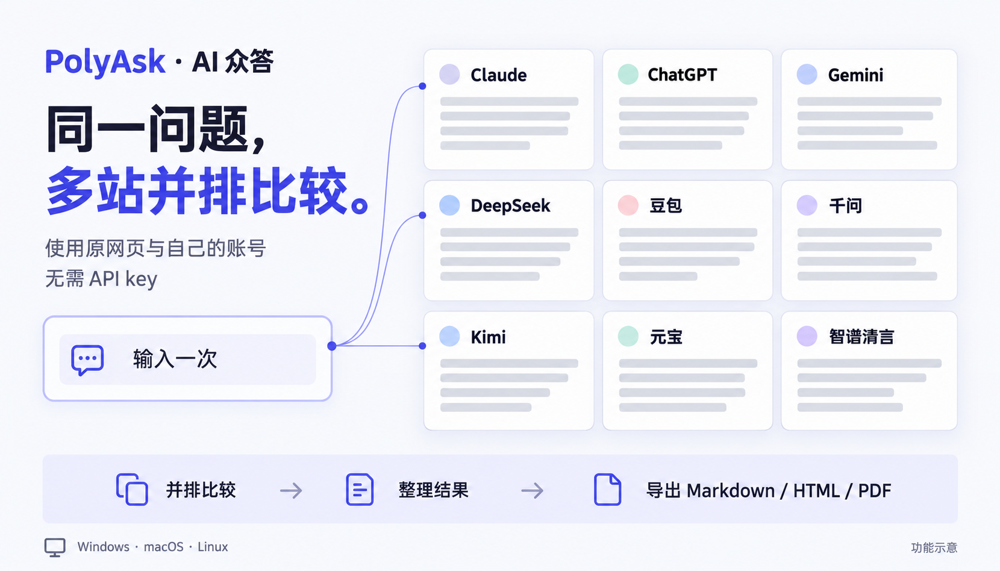

# PolyAsk · AI 众答

把同一个问题同时发给多家 AI，在同一个窗口里并排比对回答。



*示意图。应用内直接加载各站原网页，实际界面随各站更新变化。*

支持 Claude、ChatGPT、Gemini、DeepSeek、豆包、千问、Kimi、元宝和智谱清言。直接登录你自己的网页端账号，无需配置 API Key。

## 核心功能

- **一次群发**：输入问题后同步发给勾选的 AI，支持附带最多 4 张 PNG 或 JPEG 图片（总计不超过 10 MiB）。
- **并排阅读**：总览、对决（1v1 双栏等宽对照）与聚焦三种视图自由切换，支持站点排序、常用分组、多页翻页与单站独立缩放。
- **统一档位**：顶栏一键切换「深度思考」或「快速」，也可在设置中为每家站点单独指定两档对应的网页模型与思考强度。
- **跨站查找**：按 `Ctrl+F` 在所有已打开 AI 页面当前加载的文字中定位关键词。
- **模板与任务准备**：内置及自建带填空项的提问模板；可组合目标分组、档位与评估维度，预览后填入提问框。
- **历史与结果库**：自动留存每次提问、附图与回答，支持加星、标签、任务文件夹整理，以及导出 Markdown、HTML 或 PDF 报告。
- **综合、追问与决策卡**：将多站回答交给指定 AI 归纳异同，或划选片段定向追问；在双栏对照旁直接摘录多段原文依据，写下结论存为决策卡。
- **多款主题**：内置 Platinum、简约、校样室、掌机、蓝图、暗房、日晷七款主题，明暗模式随系统自动切换，不影响 AI 原网页样式。
- **同步与备份**：可选通过 Google Drive 同步跨设备记录，或导出含提问原图的 `.polyask` 本地备份文件。

> 本文对应当前源码功能；各发行包具体变更见 [更新日志](CHANGELOG.md)。

## 下载与安装

前往 [Releases](https://github.com/pine2D/polyask/releases) 下载对应系统的文件（macOS 需 13 Ventura 及以上）：

| 系统 | 文件 | 安装或运行方式 |
| --- | --- | --- |
| Windows x64 安装版 | `polyask-desktop-vX.Y.Z-windows-x64.exe` | 直接运行安装程序 |
| Windows x64 便携版 | `polyask-desktop-vX.Y.Z-windows-x64-portable.zip` | 完整解压后运行 `PolyAsk Portable/App/polyask-desktop.exe` |
| Ubuntu / Debian x64 | `polyask-desktop-vX.Y.Z-linux-x64.deb` | `sudo apt install ./polyask-desktop-vX.Y.Z-linux-x64.deb` |
| macOS Apple Silicon | `polyask-desktop-vX.Y.Z-macos-arm64.zip` | 解压后将 `PolyAsk.app` 拖入「应用程序」 |
| macOS Intel | `polyask-desktop-vX.Y.Z-macos-x64.zip` | 解压后将 `PolyAsk.app` 拖入「应用程序」 |

- **首次打开放行**：五个发行包均未签名（macOS 未公证）。首次启动若被拦截，Windows 点 SmartScreen「更多信息 → 仍要运行」；macOS 到「系统设置 → 隐私与安全性」底部点「仍要打开」。
- **手动升级与校验**：无自动更新，可通过「设置 → 查看最新版本」下载（同名 `.sha256` 供按需校验完整性，日常无需下载）。Windows 便携版升级时先完全退出应用，仅替换整个 `App` 目录并保留 `PolyAsk Data`，即可保留登录状态与本机数据。

## 常用快捷键

| 快捷键 | 作用 |
| --- | --- |
| `Ctrl+F` | 跨站查找页面文字 |
| `Alt+Q` | 展开提问框 / 收起并回到当前 AI 页面 |
| `Alt+1` / `Alt+2` / `Alt+3` | 切换站点分页 |
| `Alt+T` / `Alt+Y` | 切换深度思考 / 快速 |
| `Alt+S` | 打开站点与分组 |
| `Alt+C` | 采集回答 |
| `Alt+N` | 为参与站点开启新会话 |
| `Alt+H` | 查看站点状态与诊断 |
| `Ctrl+Shift+P` | 打开命令面板（可在设置改为 `Ctrl+P`） |
| `Ctrl+,` | 打开设置 |

macOS 将 `Ctrl` 换为 `Cmd`；完整按键表可在命令面板搜「快捷键」，跨应用唤起提问框的全局快捷键可在「设置 → 操作与快捷键」开启。各站默认对应的模型见 [站点适配说明](docs/adapters.md)。

## 数据、隐私与网络代理

- **直连原站**：提问直接在各站原网页提交，不经过任何 PolyAsk 服务器；登录状态独立保存在本机，不读取系统浏览器 Cookie。
- **附图与原图同步**：单次最多发送 4 张 PNG 或 JPEG 图片（总计不超过 10 MiB），提问历史默认在本机保留原图、文件名与 EXIF。原图同步开启后会将原图、文件名及 EXIF 一并上传至 Drive；开启前须将所有同步设备的 PolyAsk 升至最新版，否则旧版遇到新图片格式会暂停全部上传。
- **Google Drive 同步**：仅访问应用专属隐藏目录（`drive.appdata`），无权读取其他网盘文件；云端记录为明文 JSON，无端到端加密。草稿同步关闭后云端既有草稿仍保留；断开 Drive 连接不会删除任何数据。
- **删除与重置边界**：移出或删除任务文件夹只解除归类，不删原记录；删除结果会保留已建决策卡里的摘录（要彻底清除请删决策卡或在设置单独清空）。按分类清空会同步删除其他设备记录；「重置全部本机数据」会先断开 Drive 再清空本机（含自动快照），云端数据保留不动。
- **备份、快照与导出**：`.polyask` 备份不含站点登录状态、凭据与本机专属设置，导入前可逐条核对冲突；升级改写本机数据库前会自动在本机留存最多 5 份恢复快照（不上传云端）。HTML/PDF 报告仅读取本机已存文字与静态渲染的公式/Mermaid 图表，不含提问原图，也不自动加载远程图片。
- **网络代理**：支持跟随系统、直连或自定义 HTTP / HTTPS / SOCKS4 / SOCKS5 代理，统一作用于 AI 页面与 Drive 同步，代理未生效时暂停联网防绕过。HTTP 代理明文传输账号密码；SOCKS 不支持账号密码，SOCKS4 在本机解析域名且不支持 IPv6；Windows 遇 NTLM / Negotiate 认证时使用当前系统登录身份。代理密码加密存本机（无系统密钥环时仅当次运行有效），不同步不入备份；同步传来的新代理地址需在本机确认后生效（macOS 代理尚未经真机核验）。

## 已知边界与问题反馈

- **不自动重发**：网页改版可能影响切档或提交确认。切档未确认时照常发送；提示「发送未确认」时不自动补发，先查看原站页面再决定是否重试，避免重复提问。
- **人工核实**：网页显示模型不代表服务端实际调用模型；补充分析与决策卡状态（含「已定稿」）均需人工核实事实。
- **查找范围**：跨站查找仅搜索页面当前已加载的文字，不含未滚动加载的旧对话与图片内文字。

遇到站点失灵或异常，按 `Alt+H` 复制报告（页面改版可在单站详情导出脱敏快照），提交至 [GitHub Issues](https://github.com/pine2D/polyask/issues/new/choose)。诊断报告与脱敏快照均自动剔除聊天内容、完整网址、账号、Cookie 与本机路径。

## 本地开发

需 Node.js 24 及以上：

```bash
cd desktop
npm ci
npm test
npm start
```

架构、契约与验收规范见 [文档目录](docs/README.md)。早期 Chrome 扩展已停止维护，最后一版保留在 `archive/extension-v0.25.1` 标签。

## 许可证

MIT，详见 [LICENSE](LICENSE)。
