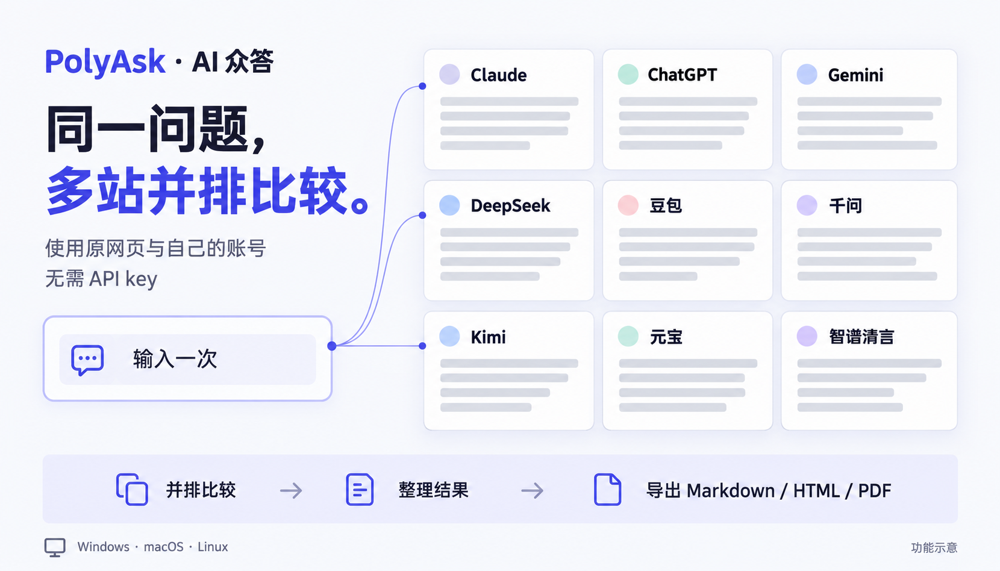

# PolyAsk · AI 众答

PolyAsk 是一个桌面应用，可将同一个问题发给多个 AI，并排比较回答。



*功能示意图。各站使用原网页，实际界面随站点更新。*

支持 Claude、ChatGPT、Gemini、DeepSeek、豆包、千问、Kimi、元宝和智谱清言。使用各站的原网页和你自己的账号，无需 API key。

## 主要功能

- **多站提问**：一次输入，发送给勾选的 AI；支持最多 4 张 PNG 或 JPEG 图片，总计不超过 10 MiB。
- **并排阅读**：宫格或聚焦布局，支持分页、站点排序和分组，换页不打断生成。
- **统一档位**：一键切换“深度思考”或“快速”，发送前逐站设置。
- **跨站查找**：用 Ctrl+F 搜索已打开 AI 页面当前加载的文字，支持逐个定位和仅搜索当前站点。
- **提问模板**：使用内置模板或保存常用提示词，填写变量后再提问。
- **历史与结果库**：回看提问、原图和回答副本，可将完整提问恢复为草稿；结果可搜索、收藏、按标签和任务文件夹整理，导出 Markdown、HTML 或 PDF 报告。
- **综合与追问**：选择已有回答交给一家 AI 综合，或引用摘录开新会话追问。
- **比较与决策**：对照回答、摘录依据，手动记录结论和理由，保存为决策卡。
- **桌面操作**：可设置仅本机生效的全局提问快捷键；完成通知支持测试与点击定位。系统通知的实际显示取决于操作系统支持及通知设置。
- **同步与备份**：可通过 Google Drive 同步历史、模板和结果库，也可导出含提问原图的 `.polyask` 备份并恢复。

> 以上功能对应当前源码；下载包的功能请查看对应版本的 [更新日志](CHANGELOG.md)。

## 安装

到 [Releases](https://github.com/pine2D/polyask/releases) 下载对应系统的文件。macOS 需要 13（Ventura）或更高版本。

| 系统 | 文件 | 安装方式 |
| --- | --- | --- |
| Windows x64 | `polyask-desktop-vX.Y.Z-windows-x64.exe` | 运行安装程序 |
| Windows x64 便携版 | `polyask-desktop-vX.Y.Z-windows-x64-portable.zip` | 完整解压，运行 `PolyAsk Portable/App/polyask-desktop.exe` |
| Ubuntu / Debian x64 | `polyask-desktop-vX.Y.Z-linux-x64.deb` | `sudo apt install ./polyask-desktop-vX.Y.Z-linux-x64.deb` |
| macOS Apple Silicon | `polyask-desktop-vX.Y.Z-macos-arm64.zip` | 解压，将 `PolyAsk.app` 拖入“应用程序” |
| macOS Intel | `polyask-desktop-vX.Y.Z-macos-x64.zip` | 解压，将 `PolyAsk.app` 拖入“应用程序” |

安装包均未签名，macOS 包未公证。首次启动被拦截时，Windows 可在 SmartScreen 中选择“更多信息 → 仍要运行”；macOS 可到“系统设置 → 隐私与安全性”选择“仍要打开”。

没有自动更新，可在设置中点击“查看最新版本”下载新包。每个包附有同名 `.sha256` 校验文件。

Windows 便携版升级：退出应用，替换整个 `App` 目录，保留 `PolyAsk Data`，避免丢失设置、登录状态和本机数据。

## 开始使用

1. 打开应用，在需要使用的 AI 站点中分别登录。
2. 勾选站点，选择“深度思考”或“快速”，输入问题并发送。
3. 并排阅读回答，按需收集到结果库、复制或导出。

顶部“更多 → 开始使用”提供操作指南，`Ctrl+Shift+P`（macOS 为 `Cmd+Shift+P`）可搜索应用命令。各站模型预设见 [站点适配说明](docs/adapters.md)。

## 常用快捷键

| 快捷键 | 功能 |
| --- | --- |
| `Ctrl+F` | 跨站页面查找 |
| `Alt+Q` | 聚焦提问框 |
| `Alt+T` / `Alt+Y` | 深度思考 / 快速 |
| `Alt+S` | 选择站点与分组 |
| `Alt+C` | 收集回答 |
| `Alt+N` | 新建会话 |
| `Alt+H` | 查看站点状态与诊断 |
| `Ctrl+Shift+P`（macOS `Cmd+Shift+P`） | 打开命令面板；可在设置中改为本机 `Ctrl+P` / `Cmd+P` |
| `Ctrl+,` | 设置 |

macOS 上将 `Ctrl` 换为 `Cmd`。完整快捷键可在命令面板搜索“快捷键”查看。

全局提问快捷键默认关闭，可在设置的“显示与操作”中配置；需要有已打开的 PolyAsk 窗口。它不参与同步和备份，重置本机数据后关闭。

HTML/PDF 报告从结果或决策卡的“更多”菜单导出，只包含已保存的文字；不包含提问原图或回答图片，公式和图表保留为文字或代码。导出不改变来源记录。

## 数据与隐私

- 问题通过各站原网页发送，不经过 PolyAsk 中转服务器。站点登录状态保存在本机，不读取系统浏览器的 Cookie。
- 图片仅支持 PNG 和 JPEG，一次最多 4 张、总共 10 MiB，提问时只发送给你勾选的站点；提问历史默认在本机保留原图、文件名和 EXIF。
- 图片同步默认关闭，可在设置中单独确认开启：已有及新保存的原图会上传至 Drive，并下载其他设备的原图，占用本机和 Drive 空间。开启前请升级所有设备上的 PolyAsk，旧版见到新图片格式后会停止上传全部同步数据。关闭只停止图片传输，保留本机图片和队列，相关删除标记仍会同步；`.polyask` 备份包含原图；缺图时可明确选择补下载、取消或仅导出文字。仅文字备份会列明省略的原图。
- Google Drive 同步可选，数据以明文存储，没有端到端加密；仅访问应用专属隐藏目录，无权读取你的其他 Drive 文件。
- 草稿默认只保存在本机。开启草稿同步后，表单文字和摘录也会上传到 Drive；关闭同步不会删除已有云端副本。
- 断开 Drive 连接不会删除数据。“重置全部本机数据”只清空本机，保留云端数据。
- 移出内容或删除任务文件夹只解除关联，不删除原内容。删除来源结果会保留决策卡及其中的摘录；要移除卡片与摘录，请删除决策卡或在设置中单独清空。
- `.polyask` 备份不含站点登录、OAuth 凭据或本机图片同步开关；仍可读取旧版 JSON 备份。恢复前可预览冲突，默认保留本机版本；恢复已删除内容需明确选择，连接 Drive 时导入的变更也会同步。

## 网络代理

- 在设置中选择“跟随系统”“不使用代理”或自定义 HTTP、HTTPS、SOCKS4、SOCKS5 代理。统一用于 AI 页面和 Drive 同步，设置未生效时停止联网。
- 代理密码加密保存在本机，不同步、不进备份或诊断报告，只交给指定代理；没有可用安全存储时仅在本次运行有效。同步带来的新代理地址需在本机确认。
- SOCKS 代理不支持用户名密码，SOCKS4 在本机解析域名且不支持 IPv6。Windows 代理要求 NTLM / Negotiate 认证时，会自动使用当前 Windows 登录身份。
- WSL 等环境无法读取桌面系统代理时，可改用自定义代理。代理功能尚未在 macOS 真机验证。

## 使用限制与报障

- 各站需要登录，并受账号额度和文件处理规则限制；上传失败时不会继续发送缺图的问题。
- 网站改版可能影响切档或发送。切档未确认仍会继续发送；提交不确定时不自动重发，请先查看原站，再确认是否重试。
- AI 综合和决策卡中的内容仍需人工核对，保存或标记“已定稿”不代表事实已核实。
- 页面查找不覆盖未加载的旧对话或图片中的文字。

遇到问题，按 `Alt+H` 复制诊断报告，提交到 [问题反馈](https://github.com/pine2D/polyask/issues/new/choose)。报告不含对话、网址、账号或文件路径。

## 开发与文档

使用 Node.js 24 或更高版本：

```bash
cd desktop
npm ci
npm test
npm start
```

架构、站点适配和验证方法见 [文档目录](docs/README.md)。旧 Chrome 扩展已停止维护，最后一版代码保留在 `archive/extension-v0.25.1` 标签中。

项目附带 [polyask-electron 技能](.agents/skills/polyask-electron/SKILL.md)，供支持 Agent Skills 的开发助手按本项目契约执行 Electron 升级、原生验证和性能分析；无需全局安装通用套件。

## License

MIT，见 [LICENSE](LICENSE)。
